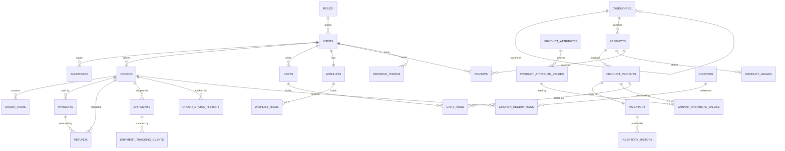
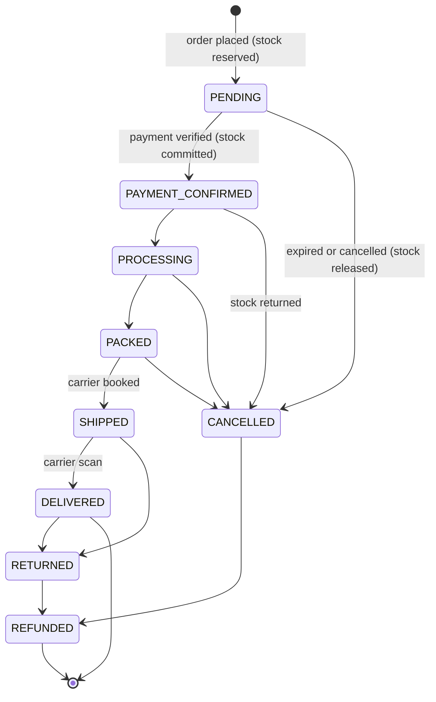

# Entity Relationship Diagram

37 tables across seven domains. Rendered with Mermaid — GitHub and most IDEs
display it inline.

## Domain map

## Order → payment → fulfilment

## Table reference

### Identity & access
| Table | Purpose | Notes |
|-------|---------|-------|
| `roles` | Role definitions with a permission array | Seeded: ADMIN, MANAGER, SUPPORT, CUSTOMER |
| `users` | Accounts | Soft-deleted; `status` gates access on every request |
| `refresh_tokens` | Rotating sessions | Stores SHA-256 hash only; `family` enables reuse detection |
| `password_reset_tokens` | Reset links | Hashed, single-use, 1-hour expiry |
| `email_verification_tokens` | Verification links | Hashed, single-use, 24-hour expiry |
| `addresses` | Saved addresses | Snapshotted onto orders, never referenced by FK |

### Catalogue
| Table | Purpose | Notes |
|-------|---------|-------|
| `categories` | Self-referencing tree | Recursive CTE resolves a whole branch |
| `products` | Sellable products | Generated `tsvector`; partial indexes for live rows |
| `product_variants` | The unit actually sold | Owns SKU, price and stock |
| `product_attributes` / `product_attribute_values` | Size, Colour, Material… | Arbitrary axes, no schema change needed |
| `variant_attribute_values` | Variant ↔ option join | Drives the option matrix and faceted filters |
| `product_images` | Gallery | Optionally scoped to a variant |

### Inventory
| Table | Purpose | Notes |
|-------|---------|-------|
| `inventory` | Quantity and reservations per variant | `CHECK(reserved <= quantity)` |
| `inventory_history` | Every movement, append-only | RESTOCK, SALE, RETURN, RESERVATION, RELEASE, ADJUSTMENT, DAMAGE |

### Shopping
| Table | Purpose | Notes |
|-------|---------|-------|
| `carts` | Member and guest carts | Partial unique index on ACTIVE carts only |
| `cart_items` | Lines | Prices re-resolved from the catalogue on every read |
| `wishlists` / `wishlist_items` | Saved items | Explicit dedupe because of NULL semantics |

### Orders & money
| Table | Purpose | Notes |
|-------|---------|-------|
| `orders` | Financial record | Address JSON snapshots; totals in `DECIMAL(12,2)` |
| `order_items` | Line snapshots | Product name, SKU, price frozen at purchase |
| `order_status_history` | Lifecycle audit | Records actor and note per transition |
| `payments` | Gateway attempts | Unique `idempotencyKey`; raw payload retained |
| `payment_webhook_events` | Inbound webhooks | `UNIQUE(provider, eventId)` makes replay a no-op |
| `refunds` | Full and partial refunds | Cumulative total capped by CHECK constraint |

### Fulfilment
| Table | Purpose | Notes |
|-------|---------|-------|
| `shipments` | Carrier consignments | AWB, label, tracking URL |
| `shipment_tracking_events` | Carrier scans | Mirrored locally so tracking survives provider outages |

### Merchandising & operations
| Table | Purpose | Notes |
|-------|---------|-------|
| `coupons` | Discount rules | Percentage, fixed, free shipping; scoped to all/category/product |
| `coupon_redemptions` | Usage ledger | Enforces per-customer limits |
| `reviews` | Ratings | Verified purchase required; moderated before publication |
| `notifications` | Delivery log | Queued via BullMQ with retry and backoff |
| `audit_logs` | Who changed what | Secrets redacted before write |
| `banners` / `settings` | Homepage content and store config | Placement-scoped, schedulable |
